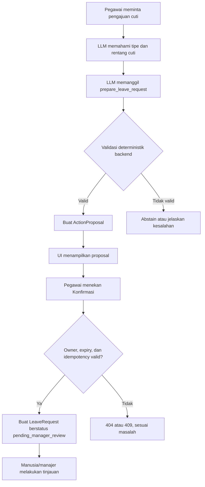

# Implementasi Sesi Chat dan Pengajuan Cuti

Dokumen ini merangkum dua hal:
1. Alur pengajuan cuti yang diharapkan instruktur pada milestone HR-Agent.
2. Mekanisme yang baru diimplementasikan pada backend, Streamlit, repository, dan pengujian.

## 1. Alur yang Diharapkan Instruktur

Pengajuan cuti harus diperlakukan sebagai **tindakan dua tahap**, bukan aksi langsung oleh model.



### Prinsip utama

1. **Identitas berasal dari bearer token**, bukan dari teks prompt atau field `employee_id` dari UI.
2. **LLM tidak boleh langsung menyetujui atau membuat leave request.**
3. Tool `prepare_leave_request` hanya membuat **proposal** yang berisi tanggal, tipe, jumlah hari kerja, ringkasan validasi, masa kedaluwarsa, dan `requires_confirmation = true`.
4. Validasi saldo, tanggal, hari kerja, masa lalu, dan overlap dilakukan oleh backend deterministik, bukan diputuskan oleh LLM.
5. Sebelum konfirmasi:
   - tidak ada record pada `leave_request`;
   - tidak ada saldo yang dipotong;
   - status pengajuan tetap belum ada.
6. Konfirmasi membutuhkan:
   - proposal milik pegawai yang sedang login;
   - proposal belum kedaluwarsa;
   - idempotency key;
   - pemeriksaan replay agar konfirmasi berulang tidak membuat request ganda.
7. Setelah konfirmasi, leave request hanya berstatus `pending_manager_review`.
8. Semua hasil perlu dapat ditelusuri melalui trace, tetapi trace tidak boleh menyimpan prompt mentah atau data sensitif.

## 2. Validasi Pengajuan yang Menjadi Hard Gate

Domain cuti di [src/domain.py](../src/domain.py) melakukan pemeriksaan berikut:

| Kasus | Hasil yang diharapkan |
| --- | --- |
| Tanggal akhir sebelum tanggal mulai | Tidak ada proposal |
| Tanggal mulai masa lalu atau hari ini | Tidak ada proposal |
| Rentang hanya Sabtu/Minggu | Tidak ada proposal karena 0 hari kerja |
| Rentang bertumpang tindih dengan request aktif | Tidak ada proposal |
| Cuti tahunan/sakit melebihi saldo | Tidak ada proposal |
| Cuti tahunan/sakit masih dalam saldo | Proposal dibuat |
| Cuti orang tua | Proposal dibuat dengan catatan bahwa HR perlu meninjau kelayakan/durasi |
| Pengguna mengaku sebagai HR atau persona lain | Tetap ditolak akses lintas pegawai |
| Pesan menyuruh approval otomatis | Tetap proposal-only dan butuh konfirmasi manual |
| Konfirmasi berulang dengan key sama | Replay menghasilkan request yang sama |
| Konfirmasi berulang dengan key berbeda | Dikembalikan sebagai konflik |
| Proposal sudah kedaluwarsa | Konfirmasi ditolak |

Contoh kontrak proposal:

```json
{
  "proposal_id": "AP-0373C24C",
  "action_type": "leave_request",
  "leave_type": "annual",
  "start_date": "2026-12-14",
  "end_date": "2026-12-15",
  "business_days": 2,
  "reason": "Liburan keluarga",
  "validation_summary": [
    "Saldo annual cukup: 8 hari, digunakan 2 hari",
    "Rentang: 2026-12-14 s/d 2026-12-15 (2 hari kerja)"
  ],
  "requires_confirmation": true
}
```

## 3. Mekanisme Sesi Chat yang Baru

Masalah awal: `AgentService.run()` selalu memulai dengan hanya pesan pengguna saat ini, sehingga LLM lupa percakapan sebelumnya meskipun `conversation_id` tersedia pada kontrak.

Mekanisme baru:

### 3.1 Pembuatan dan pemakaian `conversation_id`

- Jika request tidak menyertakan `conversation_id`, backend membuat ID baru dengan format `CV-...`.
- Backend mengembalikan `conversation_id` pada `ChatResponse`.
- Streamlit menyimpan ID ini di `st.session_state`.
- Semua pesan berikutnya dalam persona yang sama mengirim `conversation_id` yang sama.
- Tombol **Mulai percakapan baru** menghapus ID dan riwayat UI.
- Pergantian persona menghapus riwayat chat dan ID supaya percakapan tidak bocor lintas identitas.

Kontrak [src/contracts.py](../src/contracts.py) memiliki:

```python
conversation_id: str | None
```

baik pada `ChatRequest` maupun `ChatResponse`.

### 3.2 Pemuatan riwayat pada agent

Pada [src/agent.py](../src/agent.py), sebelum pemanggilan model:

1. Agent memuat riwayat percakapan milik `conversation_id` dan `employee_id`.
2. Riwayat ditempatkan sebelum pesan pengguna saat ini.
3. Pesan dikirim sebagai urutan `role = user/assistant`.
4. Setelah jawaban final, pasangan pesan user dan assistant disimpan.
5. Maksimal 20 pesan terakhir disertakan untuk membatasi konteks.

Hanya teks percakapan yang disimpan. Tool calls, tool results, prompt internal, dan chain-of-thought tidak disimpan sebagai riwayat user-facing.

### 3.3 Penyimpanan riwayat

`MemoryRepository` menyimpan:

```text
conversation_id -> daftar turn:
  employee_id
  role
  content
```

Metode repository:

- `save_conversation_turn(...)`
- `load_conversation(...)`

Keduanya melakukan filter berdasarkan employee. Artinya, `conversation_id` milik Alya tidak membocorkan riwayat Alya kepada Bima.

Pada PostgreSQL, [data/init.sql](../data/init.sql) menambahkan tabel:

```sql
conversation_turn (
    id,
    conversation_id,
    employee_id,
    role,
    content,
    created_at
)
```

`PostgresRepository` membaca/simpan turn melalui tabel tersebut. Untuk volume Docker PostgreSQL yang sudah lama, tabel perlu tersedia melalui migration atau database volume harus diinisialisasi ulang.

Implementasi saat ini juga membuat tabel `conversation_turn` secara otomatis ketika `PostgresRepository` dinisialisasi. Ini mencegah API live diam-diam kehilangan riwayat ketika volume PostgreSQL lama belum menjalankan DDL terbaru. Operasi baca/tulis riwayat tidak lagi menelan exception secara diam; kegagalan database dapat terlihat dan ditangani alih-alih dianggap sebagai sesi kosong.

## 4. Mekanisme Pengajuan Cuti yang Baru

Terdapat dua jalur pengguna yang sama-sama memakai backend yang sama.

### 4.1 Jalur lewat chat

1. Pegawai mengetik permintaan pada tab **Percakapan**.
2. Streamlit menambahkan pesan ke riwayat UI.
3. Streamlit mengirim:

```json
{
  "message": "Siapkan cuti tahunan 14 sampai 15 Desember 2026",
  "conversation_id": "CV-..."
}
```

4. API mengautentikasi bearer token dan menentukan `employee_id`.
5. Agent memuat riwayat session.
6. LLM dapat memanggil `prepare_leave_request`.
7. Tool executor memanggil Pydantic/Python domain validation.
8. Jika valid, backend menyimpan `ActionProposal` dan mengembalikan `action_proposed`.
9. UI menampilkan kartu proposal beserta tanggal, tipe, hari kerja, saldo, dan ringkasan validasi.
10. UI menampilkan tombol konfirmasi manual.

### 4.2 Jalur lewat formulir tab Permintaan Cuti

1. Pegawai memilih:
   - tanggal mulai;
   - tanggal selesai;
   - tipe cuti (`annual`, `sick`, `parental`);
   - alasan opsional.
2. Streamlit membentuk pesan natural-language, misalnya:

```text
Siapkan cuti tahunan mulai 2026-12-14 sampai 2026-12-15. Alasan: Liburan keluarga
```

3. Pesan dikirim ke endpoint `/api/v1/chat`.
4. Jalur ini masuk ke agent/tool yang sama seperti permintaan chat langsung.
5. Tidak ada endpoint khusus yang menulis leave request.
6. Proposal ditandai pada riwayat chat dan UI mengarahkan pegawai ke tab **Percakapan** untuk konfirmasi.

Ini memastikan formulir UI adalah kemudahan UX, bukan jalur backend yang membypass aturan keamanan atau validasi.

## 5. Mekanisme Konfirmasi

Satu proposal dikonfirmasi dengan endpoint:

```text
POST /api/v1/action-proposals/{proposal_id}/confirm
Authorization: Bearer <demo-token>

{"idempotency_key": "<random-stable-key>"}
```

Repository memeriksa:

1. Proposal ada.
2. Owner proposal sama dengan `employee_id` token.
3. Proposal belum kedaluwarsa.
4. Key idempotency cocok ketika proposal sudah dikonfirmasi.

Jika berhasil pertama kali:

- dibuat satu `LeaveRequestView`;
- statusnya `pending_manager_review`;
- dibuat `request_id` dan `audit_reference`;
- proposal ditandai sebagai sudah dikonsumsi.

Jika dikirim ulang dengan key yang sama:

- request lama dikembalikan;
- `idempotent_replay = true`;
- tidak ada leave request ganda.

Ini juga berlaku pada PostgreSQL melalui update transaksi dan pemeriksaan owner.

## 6. Perubahan UI

Perubahan utama pada [app.py](../app.py):

- mengganti input satu kali menjadi chat interface dengan bubble user/assistant;
- menampilkan riwayat percakapan dalam session UI;
- menyimpan dan mengirim `conversation_id`;
- menampilkan kartu proposal yang mudah dibaca;
- menambahkan tombol konfirmasi pada proposal;
- menambahkan tombol **Mulai percakapan baru**;
- menambahkan tab formulir cuti dengan date picker, tipe cuti, dan alasan;
- menambahkan pemuatan riwayat permintaan milik pengguna;
- membersihkan chat session dan confirmation key saat persona berubah.

Pergantian persona juga berlaku pada [ui_contract.py](../ui_contract.py).

## 7. File yang Diubah

| File | Implementasi |
| --- | --- |
| [src/contracts.py](../src/contracts.py) | Menambahkan `conversation_id` pada request/response |
| [src/agent.py](../src/agent.py) | Memuat dan menyimpan riwayat percakapan |
| [src/repository.py](../src/repository.py) | Menambah metode riwayat dan dukungan Memory/PostgreSQL |
| [data/init.sql](../data/init.sql) | Menambahkan tabel `conversation_turn` |
| [app.py](../app.py) | Menambah chat session UI dan formulir cuti |
| [ui_contract.py](../ui_contract.py) | Menghapus session lama saat persona berubah |
| [src/providers.py](../src/providers.py) | Mendukung parsing tanggal ISO pada deterministic provider |
| [tests/test_chat_session.py](../tests/test_chat_session.py) | Menguji sesi, isolation employee, dan riwayat |
| [tests/test_api.py](../tests/test_api.py) | Menguji proposal dari tanggal ISO |

## 8. Pengujian dan Bukti

### Pengujian otomatis

`python -m pytest -m "not live" -v --tb=short`

Hasil implementasi terakhir:

- **26 test lulus**
- **1 test live tidak dijalankan**
- mencakup API, action confirmation, domain rules, retrieval security, UI contract, dan session chat.

### Pengujian smoke browser

Pengujian lokal dengan FastAPI fake-model dan Streamlit menunjukkan:

- UI dapat membuat pesan chat dan menyimpan riwayat;
- `conversation_id` dipakai pada giliran percakapan berikutnya;
- formulir cuti menghasilkan proposal 14–15 Desember 2026 sebesar 2 hari kerja;
- kartu proposal menampilkan tanggal, tipe, saldo, dan ringkasan validasi;
- tombol konfirmasi menghasilkan leave request berstatus `pending_manager_review`;
- riwayat permintaan dapat dimuat melalui endpoint milik pengguna.

## 9. Kesesuaian dengan Alur Instruktur

| Komponen instruktur | Status implementasi |
| --- | --- |
| Chat + retrieval + tool | Sudah ada |
| Identity-bound private data | Sudah ada |
| Proposal-only leave action | Sudah ada |
| Validasi domain deterministik | Sudah ada |
| Confirmation manual | Sudah ada |
| Pending manager review | Sudah ada |
| Idempotency replay | Sudah ada |
| Sesi percakapan yang berkelanjutan | Sudah ditambahkan |
| Formulir pengajuan cuti | Sudah ditambahkan |
| Tinjauan manajer nyata | Belum termasuk; memang tetap boundary manusia |

## 10. Ringkasan

Alur utama yang sekarang harus di-demo-kan adalah:

```text
Employee memilih persona
→ mengajukan pertanyaan atau memakai formulir cuti
→ backend memvalidasi proposal
→ UI menampilkan proposal
→ employee menekan konfirmasi
→ leave request dibuat sebagai pending_manager_review
→ riwayat chat tetap tersedia dalam session
→ pergantian persona atau percakapan baru membersihkan session UI
```
