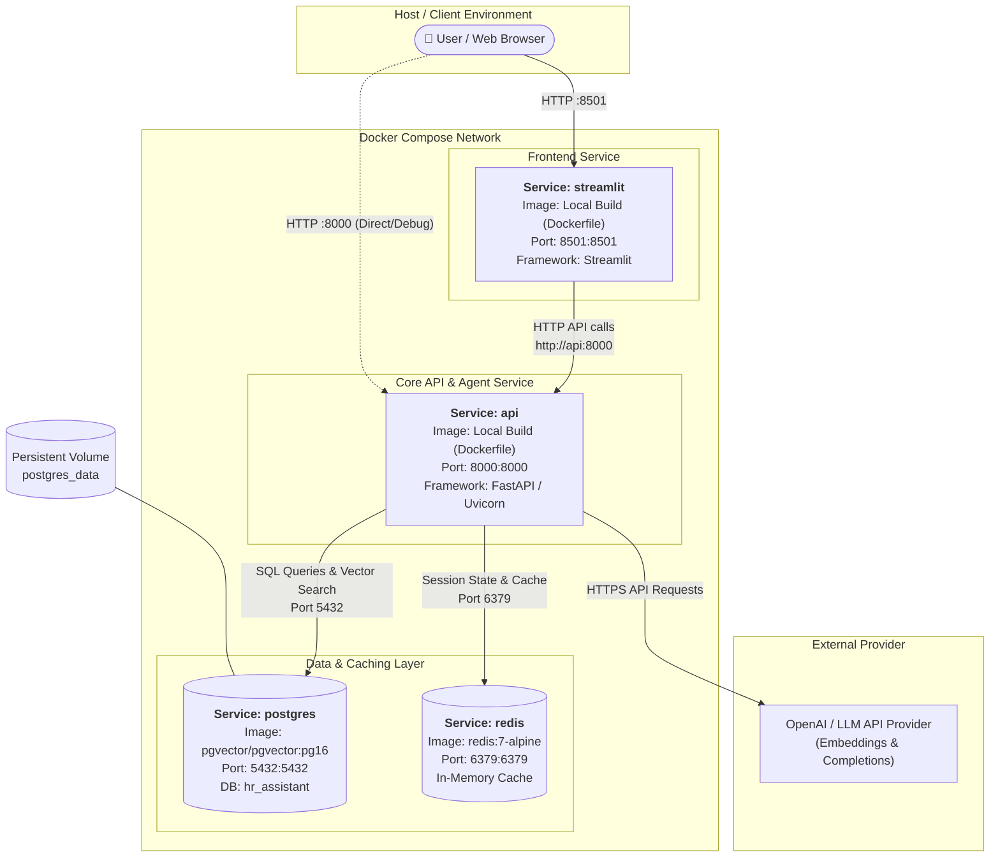

# Container Services Architecture

Diagram berikut menggambarkan interaksi dan topologi service container yang berjalan di Docker Compose.

## Spesifikasi Service

| Service | Image / Base | Port (Host:Container) | Dependensi | Deskripsi & Tanggung Jawab |
|---|---|---|---|---|
| **`streamlit`** | Build lokal ([Dockerfile](Dockerfile)) | `8501:8501` | `api` | UI interaktif untuk chat HR, visualisasi persona, dan interaksi user. |
| **`api`** | Build lokal ([Dockerfile](Dockerfile)) | `8000:8000` | `postgres`, `redis` (healthy) | Backend FastAPI yang menjalankan reasoning loop AI agent, eksekusi tools, dan RAG retrieval. |
| **`postgres`** | `pgvector/pgvector:pg16` | `5432:5432` | - | Relational database (data karyawan/request) + vector extension untuk policy documents retrieval. |
| **`redis`** | `redis:7-alpine` | `6379:6379` | - | In-memory key-value cache untuk caching query, context/session state, dan resilience. |